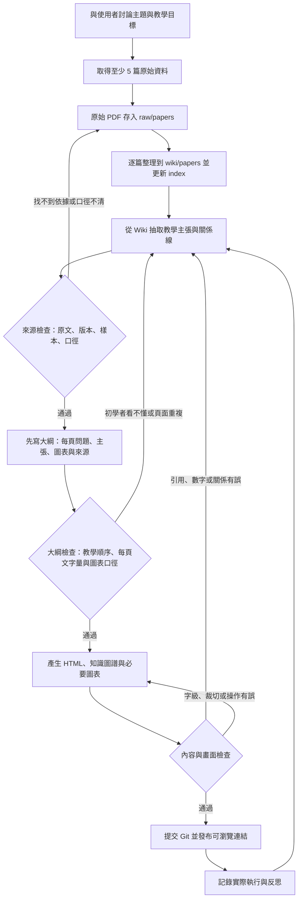

# 金融科技 LLM Wiki：簡報製作 loop / graph

本專案有兩種 graph，作用不同：

1. **工作流程 graph**：追蹤資料如何進入 Wiki、如何被查核，以及何時可變成投影片。本頁說明作業要求的 loop / graph。
2. **簡報中的知識關係圖**：把論文、概念、結果與限制連起來，協助初學者理解各研究回答的問題。

## 工作流程圖

## 為什麼這樣設計

| 節點 | 輸入與產出 | 檢查及回路 |
|---|---|---|
| 取得資料 | 以公開論文及監理原文為主，保留發表頁與 PDF | 資料版本或下載來源不明時，回到原始發布頁 |
| Wiki 整理 | 每篇筆記記錄問題、方法、結果、限制，並由索引導覽 | 不把摘要直接當成全文；缺少方法或限制時重讀 PDF |
| 主張抽取 | 每個圖譜節點與連線附上來源、地區、期間、研究類型 | 區分因果估計、統計相關、觀察順序及分析者推論 |
| 數字查核 | 查原文圖表、分母、單位、指標與版本 | 不同口徑不可拼在同一張比較圖；不清楚就撤下該圖 |
| 大綱檢查 | 每頁先有一個教學問題、短結論、圖表口徑及文字量，再決定圖與文字 | 若初學者無法理解前置概念，往前補教學頁；文字過多時提前拆頁 |
| HTML 檢查 | 檢查畫面、鍵盤翻頁、圖像、連結、列印與窄螢幕 | 內容錯回主張抽取；版面錯回 HTML 產生 |
| 發布與反思 | 保留 Git 版本、簡報網址與實際檢查紀錄 | 從重複出錯的節點調整更早的檢查點 |

## 這次的四個主題

- [股票分析](presentations/stock-analysis.html)：新聞、推文與歷史報酬如何形成模型預測，以及如何驗證。
- [金融 AI](presentations/financial-ai.html)：資料、領域模型、金融任務、基準測試與代理平台；作為本次作業的主要教學示例。
- [數位銀行](presentations/digital-banking.html)：資訊查詢、交易、採用意願與實際使用之間的關係。
- [金融 AI 治理與金融穩定](presentations/ai-governance.html)：風險辨識、監測能力與治理措施。

Wiki 目前有 15 篇單篇來源筆記，主要教學示例「金融 AI」直接使用 5 篇。原始 PDF 存在本機 `raw/papers/`，公開 GitHub 儲存庫依使用者選擇不包含 `raw/`；每篇 Wiki 筆記仍提供原始發表網址。

## 實際執行與反思

瀏覽器與內容檢查的實際發現、修正與結果已記在 [執行紀錄](EXECUTION_LOG.md)。反思只引用實際發生的問題，不把預期風險寫成已發生事件。
