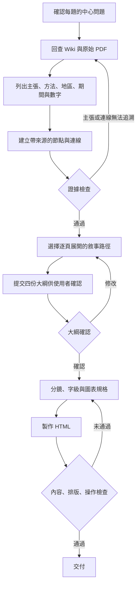

# 四主題 Graph 簡報：流程與大綱草案

> 狀態：2026-11-16 已依使用者「依照 graph 做出四個主題的 HTML」要求實作。此檔保留製作前的大綱與檢查規劃；實際頁數及查核結果見各簡報與根目錄 `EXECUTION_LOG.md`。

## 共用目標

四個主題各做一份 HTML 簡報，使用同一套圖形語言：知識圖譜呈現「研究、方法、概念、結果、限制」的關係；只有原文提供同口徑、可核對的數字時，才補上數據圖表。簡報沿用柔和粉彩、深色圓潤線條與既有 `assets/` 插畫，但圖像不可取代證據。

## 工作流程與關卡

### 證據圖的規則

- **節點**：來源論文／報告、研究方法、概念或機制、觀察到的結果、適用情境與限制。
- **連線**：區分「因果估計」「統計相關」「觀察順序」「作者建議」「本簡報推論」。線的樣式與文字標籤須同時表明類型，不能只靠顏色。
- **每條關鍵線的紀錄**：原文 URL、本地 PDF 名稱、頁碼或圖表編號、地區、資料期間、方法，以及一行限制。未回查原文的線暫不進投影片。
- **畫面節奏**：先顯示全圖，再逐頁聚焦一條路徑，最後回到全圖比較。每頁突出少量節點；其餘關係退到背景，避免「一頁蜘蛛網」。
- **數據圖表准入**：數值、分母、單位、期間與原文表格須核對；跨研究的指標或模型設定不同時分開畫，不做同軸排名。沒有可靠數字的題目改用關係矩陣或流程圖。

### 每頁大綱應填欄位

「本頁要回答的問題｜一句可被證據支持的結論｜新增／聚焦的節點與線｜圖表與數據口徑｜原文頁碼／圖號｜限制｜預計使用的素材」。大綱確認前只決定論證與畫面順序，不寫 HTML。

## 四個主題的暫定敘事

以下是**段落順序**，不是固定頁數。數據圖表候選仍須依原文表格核對。

### 甲、股票分析：LLM 的訊號如何走到可驗證的預測？

1. **總圖與問題**：新聞、推文與歷史價格等輸入，如何經過模型形成預測，再接受樣本外與交易可行性檢查？
2. **新聞路徑**：[Lopez-Lira、Tang](../wiki/papers/LopezLiraTang2023-StockPriceForecast.md) 的新聞標題、GPT-4 評分與後續報酬；將市場初始反應與可交易的後續漂移畫成不同節點。
3. **零樣本路徑**：[Xie 等](../wiki/papers/Xie2023-WallStreetNeophyte.md) 的推文／價格輸入、提示方式與基準模型；只比較論文內相同任務和指標的結果。
4. **預測偏差路徑**：[Chen 等](../wiki/papers/Chen2024-HistoricalStockReturns.md) 的近期報酬外推、樂觀偏差與區間校準。
5. **交叉比較**：三篇對「預測」的定義、輸入與評估期間不同；用研究設定矩陣對照。數據圖表候選為單篇論文內的模型與基準結果，待核對原文表格後決定。
6. **邊界與結論**：資料時間點、樣本外設計、交易成本、模型版本；不得把命中率寫成可實現報酬。

### 乙、金融 AI：模型能力從哪裡來，又如何驗證？

1. **總圖與問題**：資料 → 領域模型／代理平台 → 金融任務 → 基準測試 → 實際使用限制。
2. **資料與模型**：[BloombergGPT](../wiki/papers/Wu2023-BloombergGPT.md) 的金融與一般語料混合訓練；[FinGPT](../wiki/papers/Yang2023-FinGPT.md) 的資料整理與輕量微調。圖表候選：BloombergGPT 原文所列兩類訓練詞元量，標明它是資料組成，並非表現分數。
3. **任務如何被測量**：[FinQA](../wiki/papers/Chen2021-FinQA.md) 的財報數值推理步驟與 8,281 題；示範「擷取支持資料 → 計算 → 答案」的可檢查路徑。
4. **廣度與弱點**：[FinBen](../wiki/papers/Xie2024-FinBen.md) 的 24 項任務、36 個資料集與 15 個受測模型。若使用表現圖，只選同一版本、相同指標的原文結果。
5. **系統層**：[FinRobot](../wiki/papers/Yang2024-FinRobot.md) 如何串接任務、模型與資料；架構展示與有效性驗證分開呈現。
6. **交叉結論**：模型專用化、基準測試成績與金融工作可靠性是三個不同問題。

### 丙、數位銀行：客戶何時開始使用，如何擴大使用？

1. **總圖與問題**：實體通路、服務認知、操作能力、信任與情境風險，連到「意願」「接受度」或「實際使用」；三種結果分開標示。
2. **實體通路**：[Choi、Loh](../wiki/papers/ChoiLoh2023-PhysicalFrictionsDigitalBanking.md) 的新加坡 ATM 關閉事件與數位交易；[Carbo-Valverde 等](../wiki/papers/CarboValverde2020-DigitalizationBankCustomers.md) 的西班牙分行關閉結果。圖上標明不同設施與研究設計。
3. **使用順序**：西班牙研究的資訊查詢 → 交易使用；圖表候選為同一調查中查餘額與付款／轉帳的比例，分母必須照原文標示。
4. **尚未使用者**：[Shaikh 等](../wiki/papers/Shaikh2023-IslamicDigitalBankingAdoption.md) 的巴基斯坦 208 位非使用者；技術自我效能等因素連到採用意願。
5. **既有使用者**：[Nguyen 等](../wiki/papers/Nguyen2024-DigitalBankAcceptanceVietnam.md) 的越南 779 位使用者；可將同一模型內的標準化係數畫成條圖，註明「風險」指疫情感染風險。
6. **交叉結論與限制**：四篇的地區、客群、時期和應變項不同；產品設計只能列為待驗證假設。

### 丁、金融 AI 治理與金融穩定：從風險辨識走到監測與措施

1. **總圖與問題**：AI 採用 → 潛在脆弱性 → 可監測訊號 → 治理措施；用連線標明何者是監理機構的風險評估、何者是實務建議。
2. **風險辨識**：[FSB 2024](../wiki/papers/FSB2024-FinancialStabilityAI.md) 的第三方集中、模型與資料風險、網路風險、市場相關性等分類。
3. **監測能力**：[FSB 2025](../wiki/papers/FSB2025-AIMonitoring.md) 討論 AI 採用的監測指標、定義差異與資料缺口；把「風險」和「可取得的監測資料」分開。
4. **治理措施**：[FSB 2026](../wiki/papers/FSB2026-ResponsibleAIAdoption.md) 的 12 項實務建議，依治理、評估、資料、人類監督、資安與第三方風險等面向連回風險節點。
5. **對照與缺口**：以「風險 × 監測方式 × 實務措施」矩陣找出有措施但缺數據、或有監測但定義不一致的地方。目前不預設數值圖表；若原文沒有可比較的量化資料，就維持關係圖與矩陣。
6. **適用範圍**：FSB 報告屬國際監理分析及實務建議，不直接等於各國現行法律；若描述現行規定，須另外查證司法管轄區與日期。

## 製作前後的檢查清單

1. **來源**：每個重要節點、連線與數字能從 Wiki 回到 PDF 的具體頁碼／圖表；預印本版本及監理報告發布日期清楚。
2. **論證**：相關、先後順序、因果估計和設計推論各用正確標籤；不同研究的樣本和指標不混成同一結論。
3. **大綱**：每頁只承載一個核心結論；新增的圖譜關係有敘事作用；四份簡報有相同圖例與版型規則。
4. **圖表**：數字、分母、單位、指標方向與原文一致；沒有截斷或誇張比例；來源和限制在圖旁可讀。
5. **HTML**：桌面與窄螢幕無裁切或重疊；字級層級一致；鍵盤翻頁、連結、圖片相對路徑與列印可用。

## 待使用者確認

- 四題的中心問題與段落順序是否符合作業重點？
- 四份簡報是否需要統一大致篇幅，還是依證據量各自決定？
- 大綱確認後，先試作一份作為視覺樣板，再製作其餘三份。
